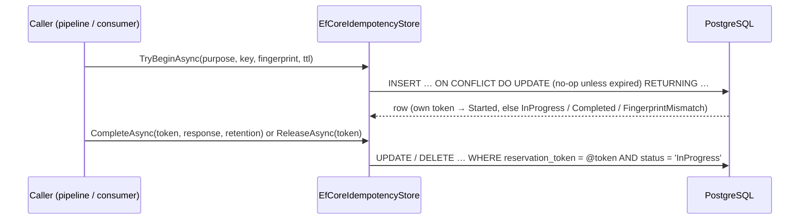

# SharedKernel.Idempotency.EfCore

[](https://dotnet.microsoft.com/)
[](https://github.com/Gresta-Vertex-Labs/platform-shared-kernel/blob/main/LICENSE)


> **The PostgreSQL implementation of `IIdempotencyStore`, for services that run PostgreSQL and do not want Redis just
> for deduplication: one `INSERT … ON CONFLICT … RETURNING` classifies a duplicate command or message atomically,
> scoped by tenant.**

Pick it when entries should live in the service's PostgreSQL database, for example next to an EF Core outbox. Pick
[`SharedKernel.Idempotency.Redis`](https://github.com/Gresta-Vertex-Labs/platform-shared-kernel/blob/main/src/Infrastructure/Idempotency/SharedKernel.Idempotency.Redis/README.md)
when the service already runs Redis and wants expiry handled by the server, with no table and no cleanup job.

| You get | So that |
| --- | --- |
| `AddEfCoreIdempotency(db => db.UsePostgres(dataSource), p => …)` | One call backs command idempotency, consumer deduplication, or both |
| One-statement upsert per reservation | No read-then-write window, no second `SELECT` |
| Table `idempotency_keys`, key `(tenant_scope, purpose, key)` | A key can never collide across tenants or between requests and messages |
| Expired rows reclaimed in place | A crashed caller cannot wedge a key |
| Fail closed, with one explicit fail-open switch | An outage never silently turns into duplicate execution; it surfaces as `IdempotencyStoreUnavailableException` |
| Spans and metrics under `SharedKernel.Idempotency` | A fail-open outage is counted and alertable, not only logged |
| Its own plain `IdempotencyDbContext`, EF retry off | The caller owns retry; the platform save pipeline cannot interfere |

## Contents

- [Install](#install)
- [Quick start](#quick-start)
- [How it works](#how-it-works)
- [Recipes](#recipes)
- [Configuration](#configuration)
- [Reference](#reference)
- [Testing](#testing)
- [Pitfalls](#pitfalls)
- [Design decisions](#design-decisions)

## Install

```xml
<PackageReference Include="SharedKernel.Idempotency.EfCore" />
```

The version comes from your central `SharedKernelVersion` property — every SharedKernel package ships at the same
version. See [Using the packages](https://github.com/Gresta-Vertex-Labs/platform-shared-kernel#using-the-packages).

| Requirement | Value |
| --- | --- |
| Target framework | `net10.0` |
| Tier | Adapter — reference it from your **Infrastructure** project |
| Depends on | `SharedKernel.Idempotency.Abstractions`, `SharedKernel.Persistence.EfCore` (for `UsePostgres`), `SharedKernel.Primitives` |
| Namespaces | `SharedKernel.Idempotency.EfCore.Extensions`, `.Context`, `.Options`, `.Store`, `.Diagnostics` |
| Database | PostgreSQL |

## Quick start

```csharp
using Npgsql;
using SharedKernel.Idempotency.EfCore.Extensions;
using SharedKernel.Persistence;
using SharedKernel.Primitives.Clocks;

builder.Services.AddClock();                                        // IClock — required
var dataSource = NpgsqlDataSource.Create(builder.Configuration.GetConnectionString("orders")!);

builder.Services.AddEfCoreIdempotency(
    configureDbContext: db => db.UsePostgres(dataSource),
    purposes: p => p.ForRequests().ForMessages());
```

Then create the table: set `o.MigrateOnStartup = true` (recipe 1) or create it yourself (recipe 2). Nothing else calls the store directly: `app.WithIdempotency()` on
`AddSharedKernelApplication` and `MessagingBusBuilder.WithIdempotency()` resolve it by purpose. To call it yourself,
inject `[FromKeyedServices(IdempotencyPurpose.Request)] IIdempotencyStore` — see the
[contract README](https://github.com/Gresta-Vertex-Labs/platform-shared-kernel/blob/main/src/Infrastructure/Idempotency/SharedKernel.Idempotency.Abstractions/README.md).

## How it works



- **One statement.** `TryBeginAsync` is one raw `INSERT … ON CONFLICT (tenant_scope, purpose, "key") DO UPDATE …
  RETURNING` on the context's own connection. Every `SET` is a no-op unless the existing row has expired, so a live
  row comes back unchanged. The caller won — fresh insert or expired-row reclaim — exactly when the returned
  `reservation_token` is its own.
- **Token-conditional.** `CompleteAsync`/`ReleaseAsync` touch the row only while the token matches and the row is
  `InProgress`, and return `false` otherwise; a malformed token is rejected without a round trip. A completed row is
  never released.
- **Tenant scope** is `IdempotencyTenantScope.Current(accessor)` — the tenant id in "D" form, or `no-tenant`.
- **Timestamps** come from `IClock`: a reservation expires at `now + ttl`; completion moves it to `now + retention`.
  The caller owns both values, so this package has no TTL settings.
- **Lifetime.** `IdempotencyDbContext` and the store are scoped.

### Table `idempotency_keys`

| Column | Type | Notes |
| --- | --- | --- |
| `tenant_scope` | `varchar(36)` | `IdempotencyTenantScope`: tenant id in "D" form, or `no-tenant` |
| `purpose` | `varchar(16)` | `Request` or `Message` |
| `key` | `varchar(512)` | the key exactly as given (a 64-hex digest for requests) |
| `fingerprint` | `varchar(128)` | |
| `status` | `varchar(20)` | `InProgress` or `Completed` |
| `reservation_token` | `uuid` | fresh per winning reservation |
| `reserved_at_utc`, `expires_at_utc` | `timestamptz` | `expires_at_utc` indexed (`ix_idempotency_keys_expires_at_utc`) |
| `response` | `text` | stored response, never parsed; `NULL` for messages |

Primary key `(tenant_scope, purpose, key)` — the constraint the upsert conflicts on.

## Recipes

### 1. Let the package create the table on startup (supported)

The package ships its own initial migration. Opt in and it creates `idempotency_keys` when the host starts, on the
migration connection, so the application's runtime role never needs DDL rights:

```csharp
builder.Services.AddSharedKernelPostgres<OrdersDbContext>(builder.Configuration, "orders");   // the lock and the migration data source
builder.Services.AddEfCoreIdempotency(
    db => db.UsePostgres(runtimeDataSource),
    p => p.ForRequests().ForMessages(),
    o => o.MigrateOnStartup = true);
```

```json
{ "SharedKernel": { "Persistence": { "orders": { "MigrationConnectionString": "Host=…;Username=app_migrator;…" } } } }
```

- **Where it runs.** On the migration data source when `MigrationConnectionString` is configured, otherwise on the
  context's own connection (a single-role host works). The store itself keeps using the connection you passed to
  `UsePostgres`.
- **Once across replicas.** Startup takes the cross-replica migration lock; a replica that waits finds the migration
  applied. `MigrationLockTimeout` (default 2 minutes) bounds the wait and fails start with a `TimeoutException`.
  Readiness (`IPersistenceStartup`) completes only after the migration. The host needs `AddSharedKernelPostgres` or
  `AddSharedKernelNpgsql` in the same container; without it the migration still runs but takes no lock.
- **History table.** Opting in records the migration in `__ef_migrations_history_idempotency` (default schema), never
  in `__EFMigrationsHistory`, so it cannot collide with your own context's migrations.
- **A table that exists already.** The migration does nothing when `idempotency_keys` exists, whoever created it and
  whoever owns it: no `ALTER`, no row change, no index statement. Only the history row is added. The shape of a
  hand-made table is not inspected, so it must follow the columns above exactly.
- **Grants.** The table is owned by the migrator. The canonical role script's `ALTER DEFAULT PRIVILEGES FOR ROLE
  app_migrator` gives the runtime role `SELECT, INSERT, UPDATE, DELETE` on it (the cleanup job in recipe 3 needs
  `DELETE`). The package grants nothing itself.
- **Revert.** The migration's `Down` drops the table and every row in it; run it only deliberately.

### 2. Create the table yourself (manual fallback)

Without the opt-in the package creates nothing. Create the table once as the owning role, with exactly this DDL:

```sql
CREATE TABLE idempotency_keys (
    tenant_scope character varying(36) NOT NULL,
    purpose character varying(16) NOT NULL,
    key character varying(512) NOT NULL,
    fingerprint character varying(128) NOT NULL,
    status character varying(20) NOT NULL,
    reservation_token uuid NOT NULL,
    reserved_at_utc timestamp with time zone NOT NULL,
    expires_at_utc timestamp with time zone NOT NULL,
    response text,
    CONSTRAINT pk_idempotency_keys PRIMARY KEY (tenant_scope, purpose, key)
);
CREATE INDEX ix_idempotency_keys_expires_at_utc ON idempotency_keys (expires_at_utc);
GRANT SELECT, INSERT, UPDATE, DELETE ON idempotency_keys TO app_runtime;
```

The grant is needed for a table that `app_migrator` did not create (the role script's default privileges only cover
tables the migrator creates). Or generate a migration of your own with a design-time factory in your migrations
project, which keeps working next to a service that does not opt in:

```csharp
using Microsoft.EntityFrameworkCore;
using Microsoft.EntityFrameworkCore.Design;
using Npgsql;
using SharedKernel.Idempotency.EfCore.Context;
using SharedKernel.Persistence;

public sealed class IdempotencyDbContextFactory : IDesignTimeDbContextFactory<IdempotencyDbContext>
{
    public IdempotencyDbContext CreateDbContext(string[] args)
    {
        var options = new DbContextOptionsBuilder<IdempotencyDbContext>();
        options.UsePostgres(NpgsqlDataSource.Create("Host=localhost;Database=orders;Username=app_migrator"));
        return new IdempotencyDbContext(options.Options);
    }
}
```

Then run `dotnet ef migrations add InitialIdempotency --context IdempotencyDbContext`. This migration lives in your
assembly and uses EF Core's default history table; do not also set `MigrateOnStartup`, or the shipped migration would
run next to it (harmlessly: it finds the table and does nothing).

### 3. Bound table growth with a cleanup job

The store never prunes rows. Run a periodic delete — a `BackgroundService`, or a
[`SharedKernel.Scheduling`](https://github.com/Gresta-Vertex-Labs/platform-shared-kernel/blob/main/src/Infrastructure/Scheduling/SharedKernel.Scheduling/README.md) job:

```csharp
using Microsoft.EntityFrameworkCore;
using Microsoft.Extensions.DependencyInjection;
using Microsoft.Extensions.Hosting;
using SharedKernel.Idempotency.EfCore.Context;
using SharedKernel.Primitives.Clocks;

public sealed class IdempotencyCleanupService(IServiceScopeFactory scopes, IClock clock) : BackgroundService
{
    protected override async Task ExecuteAsync(CancellationToken stoppingToken)
    {
        using var timer = new PeriodicTimer(TimeSpan.FromHours(1));
        while (await timer.WaitForNextTickAsync(stoppingToken))
        {
            await using var scope = scopes.CreateAsyncScope();
            var db = scope.ServiceProvider.GetRequiredService<IdempotencyDbContext>();
            await db.Database.ExecuteSqlInterpolatedAsync(
                $"DELETE FROM idempotency_keys WHERE expires_at_utc < {clock.UtcNow}", stoppingToken);
        }
    }
}
```

## Configuration

Options are set through the `configureOptions` delegate, which runs once, when `AddEfCoreIdempotency` is called (the
migration flag decides what gets registered). The registration does not bind a configuration section (the
`EfCoreIdempotencyOptions.SectionName` constant, `SharedKernel:Idempotency:EfCore`, is reserved for that), so
`SharedKernel:Idempotency:EfCore:MigrateOnStartup` in `appsettings.json` has no effect; set it in code.

| Option | Type | Default | Meaning |
| --- | --- | --- | --- |
| `EfCoreIdempotencyOptions.AllowExecutionOnStoreUnavailable` | `bool` | `false` | On a PostgreSQL connectivity or timeout failure, `TryBeginAsync` returns `Started` and `CompleteAsync`/`ReleaseAsync` return `false`, instead of throwing, and a Warning is logged. **Duplicate-execution risk while PostgreSQL is down.** Applies to every purpose of the registration |
| `EfCoreIdempotencyOptions.MigrateOnStartup` | `bool` | `false` | Create `idempotency_keys` at host start through the shipped migration, on the migration connection, under the cross-replica lock (recipe 1). Uses the history table `__ef_migrations_history_idempotency` |
| `EfCoreIdempotencyOptions.MigrationLockTimeout` | `TimeSpan?` | `null` (2 minutes) | How long startup waits for the migration lock when `MigrateOnStartup` is on. Must be positive |
| `SharedKernel:Persistence:{name}:MigrationConnectionString` | string | unset | Read by `SharedKernel.Persistence.Npgsql`, not by this package: the connection the migration runs on. Unset: the context's own connection |

## Reference

### Registration

| Method | Registers |
| --- | --- |
| `AddEfCoreIdempotency(Action<DbContextOptionsBuilder> configureDbContext, Action<IdempotencyPurposeSelection> purposes, Action<EfCoreIdempotencyOptions>? configureOptions = null)` | `IdempotencyDbContext` (scoped, retry disabled); `EfCoreIdempotencyStore` as the keyed `IIdempotencyStore` for each selected purpose (scoped); `IRequestContextAccessor` unless one exists |

It throws `InvalidOperationException` when no purpose is selected or a store is already registered for a selected
purpose. An `IClock` must be registered (`services.AddClock()`). It also calls `AddMetrics()` and registers the
singleton `EfCoreIdempotencyMetrics` that holds the instruments (it never touches the scoped context).

### Failure classification

A transient `NpgsqlException`, an `NpgsqlException` wrapping a `SocketException` or `TimeoutException`, or a bare
`SocketException`/`TimeoutException` (searched up to five inner exceptions deep, so EF Core's execution-strategy
wrapper is seen through) counts as "store unavailable". Anything else propagates raw regardless of the option, and
cancellation is never classified, wrapped or swallowed.

With the default fail-closed behavior every member throws `IdempotencyStoreUnavailableException`
(`Error.Unavailable`, code `idempotency.store_unavailable`); the database exception, or EF Core's wrapper around it,
is its `InnerException`. A `TryBeginAsync` that timed out may have left an unconfirmed reservation; it expires after
its `ttl`, so retrying the same key is safe.

> **Fail-open means duplicate execution while PostgreSQL is down.** With `AllowExecutionOnStoreUnavailable` every
> call, duplicates included, is treated as new. Watch `sharedkernel.idempotency.fail_open` and alert on it.

### Telemetry

One `ActivitySource` and one `Meter` named `SharedKernel.Idempotency` (a host subscribes through the `SharedKernel.*`
wildcard). The instruments are created from the host's `IMeterFactory`; `AddEfCoreIdempotency` calls `AddMetrics()`.
The `idempotency.provider` tag is `efcore`, which separates this package from the Redis provider in a host that
registers both (for example Requests on Redis and Messages here).

| Telemetry | Name | Unit | Tags |
| --- | --- | --- | --- |
| Span (Client) | `idempotency begin`, `idempotency complete`, `idempotency release` | | `idempotency.operation`, `idempotency.purpose`, `idempotency.provider`, `idempotency.result`, `idempotency.fail_open` (only when set), `error.type`/`error.code` on failure |
| Histogram | `sharedkernel.idempotency.operation.duration` | `s` | `idempotency.operation`, `idempotency.purpose`, `idempotency.provider`, `outcome`, `idempotency.result` |
| Counter | `sharedkernel.idempotency.fail_open` | `{operation}` | `idempotency.operation`, `idempotency.purpose`, `idempotency.provider` |

`idempotency.result` is `started`, `in_progress`, `completed` or `fingerprint_mismatch` for a begin (an expired row
that is reclaimed counts as `started`), `applied` or `lost` for a complete or release, and `fail_open` for an outage
that was let through. The key, fingerprint, token, tenant and stored response are never a tag, log value or span
attribute, and the span records an outage without the database exception text.

### Logging

| Event id | Level | Template |
| --- | --- | --- |
| 18100 | Warning | The idempotency store was unavailable during `'{Operation}'` for purpose `'{Purpose}'`, so the guarded call proceeds without duplicate protection. |

The fail-closed path logs nothing; the caller that receives the exception logs the refusal.

### Upgrading

- A fail-closed outage now throws `IdempotencyStoreUnavailableException` instead of the raw `NpgsqlException`,
  `TimeoutException` or EF Core's execution-strategy `InvalidOperationException`; catch the new type (the original is
  its `InnerException`).
- The `EfCoreIdempotencyStore` constructor takes an `EfCoreIdempotencyMetrics`; resolve the store through DI.
- The log message text changed (event id 18100 did not), and the exception text for an impossible empty `RETURNING`
  result is reworded. The `idempotency_keys` schema is unchanged: no migration is needed.
- `MigrateOnStartup` is additive and off by default. A service that created the table by hand or with its own
  migration keeps working unchanged; `AddEfCoreIdempotency` now runs the `configureOptions` delegate when it is called
  rather than when the options are first resolved. Opting in later on a database with the table already in place adds
  only the history row.

### Health

No probe of its own. The table lives in the service's database, so the service's own database readiness check
(`AddDatabaseReadinessCheck<TContext>()` from `SharedKernel.ServiceDefaults.Persistence`) covers the connection.

## Testing

Unit tests use [`SharedKernel.Idempotency.Testing`](https://github.com/Gresta-Vertex-Labs/platform-shared-kernel/blob/main/src/Infrastructure/Idempotency/SharedKernel.Idempotency.Testing/README.md):
`services.AddFakeIdempotencyStore()` replaces this store with an in-memory `FakeIdempotencyStore` that follows the
same protocol. Concurrency, tenant isolation and expiry reclaim need a real PostgreSQL (for example Testcontainers).

## Pitfalls

| Don't | Do | Why |
| --- | --- | --- |
| Forget the table | Set `MigrateOnStartup` (recipe 1) or create it (recipe 2) | Without the opt-in nothing creates it; the first call fails on a missing table |
| Run the migration on the runtime role | Configure `MigrationConnectionString` | The runtime role has no `CREATE`; start fails with permission denied |
| Set your own `MigrationsAssembly` on the context and expect the shipped migration | Leave it unset, or use recipe 2 | The shipped migration is found through the package's own assembly; a caller-set assembly replaces it |
| Create the table by hand with different columns, then opt in | Follow the DDL in recipe 2 exactly | An existing table is never inspected or altered; a drifted shape fails in the store |
| Call `Down` casually | Treat it as a drop of every entry | It drops `idempotency_keys` |
| Forget cleanup | Schedule the delete in recipe 3 | Expired rows are only reclaimed when the same key returns; the rest accumulate |
| Forget `AddClock()` | Register `IClock` | Every timestamp comes from it |
| Turn on `AllowExecutionOnStoreUnavailable` by default | Leave it off unless running twice is safer than not running | While the database is down every call — duplicates included — is treated as new |
| Expect settings under `SharedKernel:Idempotency:EfCore` | Use the `configureOptions` delegate | The section is not bound |
| Map `IdempotencyDbContext` into your own context | Keep it separate | Your context's conventions (soft delete, `xmin`) would change the table |

## Design decisions

**Why raw SQL instead of `ExecuteSqlInterpolatedAsync`?** The upsert needs its `RETURNING` row, which that API
discards; the store runs the command on the context's own ADO.NET connection instead.

**Why compare tokens, not timestamps?** Two callers can reclaim an expired row within the same clock tick; only the
token proves which one won.

**Why a plain `DbContext`?** `SharedKernelDbContext`'s save pipeline would turn the cleanup's hard `DELETE` into a
soft delete and add a row version this table has no use for.

**Why is EF retry off?** Every operation is one atomic statement, and the caller owns the request the reservation
guards. With the default retry policy an unreachable store would back off for minutes before failing.

---

Part of [Platform.SharedKernel](https://github.com/Gresta-Vertex-Labs/platform-shared-kernel) ·
[Idempotency packages](https://github.com/Gresta-Vertex-Labs/platform-shared-kernel/blob/main/src/Infrastructure/Idempotency/README.md) ·
[MIT license](https://github.com/Gresta-Vertex-Labs/platform-shared-kernel/blob/main/LICENSE)
