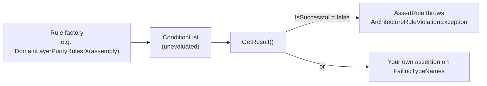

# SharedKernel.ArchitectureTests

[](https://dotnet.microsoft.com/)
[](https://github.com/Gresta-Vertex-Labs/platform-shared-kernel/blob/main/LICENSE)


> **Ready-made NetArchTest and Mono.Cecil rules you assert from your own test suite: domain purity, provider
> isolation, forbidden injection patterns and IL-level secure-default checks that no compiler warning can express.
> Reach for it when a rule needs a whole assembly; a rule about one line of code belongs to
> [`SharedKernel.Analyzers`](https://github.com/Gresta-Vertex-Labs/platform-shared-kernel/blob/main/tools/Governance/SharedKernel.Analyzers/README.md).**

| You get | So that |
| --- | --- |
| 88 static rule factories in 30 classes, returning `ConditionList` | A prose architecture rule becomes a failing test |
| `ArchitectureRuleBase.AssertRule`/`AssertRules` | A violation fails with every offending type named |
| Service shape rules (`ServiceShapeRules`) and nine placement rules (`ServicePlacementRules`) | A service's own projects and folders are held to the same layout every other service has |
| An embedded kernel package-tier index (`KernelPackageIndex`) | A test can ask which tier a package is without a copy of the list or a `docs/` folder |
| Caller-supplied anchor types, validated | Rules work against your own markers and never pass vacuously on a wrong anchor |
| IL assertion helpers (`SecureDefaultsAssertion`, `PipelineOrderAssertion`, …) | A secure default or a registration order cannot drift silently |
| Observability assertions (EventId ownership, telemetry names, log templates, error codes, suppression audit) | You adopt a platform-wide standard that fails with a per-domain breakdown |
| Public `ICustomRule` predicates | You compose your own rules from the same building blocks |
| No test runner, no assertion library | Use xUnit, NUnit or MSTest, and any assertion style |

## Contents

- [Install](#install)
- [Quick start](#quick-start)
- [How it works](#how-it-works)
- [Recipes](#recipes)
- [Reference](#reference)
- [Testing](#testing)
- [Pitfalls](#pitfalls)
- [Design decisions](#design-decisions)

## Install

```xml
<PackageReference Include="SharedKernel.ArchitectureTests" PrivateAssets="all" />
```

The version comes from your central `SharedKernelVersion` property — every SharedKernel package ships at the same
version. See [Using the packages](https://github.com/Gresta-Vertex-Labs/platform-shared-kernel#using-the-packages).

| Requirement | Value |
| --- | --- |
| Target framework | `net10.0` |
| Tier | Tooling — reference it from a **test project** only (it is a development dependency) |
| Depends on | `NetArchTest.Rules`, `Mono.Cecil`, `Microsoft.Extensions.DependencyInjection.Abstractions`; no other SharedKernel package |
| Namespaces | `SharedKernel.ArchitectureTests.Rules`, `.Helpers`, `.Predicates`, `.ServiceShape`, `SharedKernel.ArchitectureTests` (assertions) |

Add a test runner yourself. The package ships its XML documentation, so each rule's offending and compliant patterns
are in IntelliSense.

## Quick start

```csharp
using System.Reflection;
using SharedKernel.ArchitectureTests.Helpers;
using SharedKernel.ArchitectureTests.Rules;
using Xunit;

public sealed class ArchitectureTests : ArchitectureRuleBase
{
    private static readonly Assembly Domain = typeof(Order).Assembly;

    [Fact]
    public void Domain_does_not_read_the_system_clock() =>
        AssertRule(DomainLayerPurityRules.DomainAssembliesNeverCallSystemClock(Domain));

    [Fact]
    public void Domain_does_not_reference_persistence() =>
        AssertRule(PersistenceLayerProtectionRules.DomainAssembliesNeverReferencePersistenceStack(Domain));
}
```

```text
ArchitectureRuleViolationException:
  Architecture rule violated. Failing types: MyApp.Domain.Orders.Order, MyApp.Domain.Pricing.Discount
```

The same names are on `ArchitectureRuleViolationException.FailingTypeNames`.

## How it works



- **Nothing is inspected until `GetResult()`.** Every rule is a static factory; assert through `ArchitectureRuleBase` or
  skip the base class and assert on the result yourself.
- **Arrays.** `RedisTopologyRules.CapabilityPackagesNeverReferenceEachOther`,
  `SearchTopologyRules.ProviderPackagesNeverReferenceEachOther` and
  `IntelligenceTopologyRules.ProviderPackagesNeverReferenceEachOther` return `ConditionList[]` (one per assembly) — pass
  them to `AssertRules(...)`. `StorageTopologyRules.*ForbiddenAssemblyReferences` and
  `PersistenceNamespaceConventionRules.FindMisplacedExtensions` return `IReadOnlyList<string>`: empty when clean.
- **Anchors come from you.** Rules that select types by interface or base class take that type as a parameter and
  validate it (`RuleAnchor`): a class passed where an interface is required throws `ArgumentException` instead of
  selecting zero types and reporting a vacuous pass.
- **IL, not text.** Assertion helpers and several predicates read compiled method bodies through Mono.Cecil, so a check
  cannot pass by reading a comment that still says the right thing.

## Recipes

### 1. Pass your own anchor types

```csharp
AssertRule(GuardPurityRules.GuardAgainstMethodsMustNotThrow(typeof(IGuardClause).Assembly, typeof(IGuardClause)));
AssertRule(DomainGoldStandardRules.DomainServicesMustExtendAbstractBase(
    domain, typeof(IDomainService), typeof(DomainService)));
AssertRule(DomainGoldStandardRules.AggregateFactoriesMustCreateValidationResults(
    domain, typeof(IAggregateFactory<,>), typeof(ValidationResult<>)));
AssertRule(ContractsPurityRules.IntegrationEventImplementationsMustBeSealed(contracts, typeof(IIntegrationEvent)));
```

### 2. Lock a secure default in IL

```csharp
using SharedKernel.ArchitectureTests;

// The options default must stay the secure value.
SecureDefaultsAssertion.AssertEnumPropertyDefaultEquals(
    typeof(MyTlsOptions), nameof(MyTlsOptions.Mode), nameof(TlsMode.VerifyFull));

// Behaviors must be registered in this relative order.
PipelineOrderAssertion.AssertRegistrationOrder(services, typeof(MyAuditBehavior<,>), typeof(MyRetryBehavior<,>));
```

### 3. Compose your own rule

```csharp
using NetArchTest.Rules;
using SharedKernel.ArchitectureTests.Predicates;

AssertRule(Types.InAssembly(myAssembly)
     .That().ImplementInterface(typeof(IMyMarker))
     .Should().MeetCustomRule(new SingleConstructorPredicate()));
```

Or implement NetArchTest's `ICustomRule` — `MeetsRule(TypeDefinition)` receives the Mono.Cecil type, so bodies,
attributes and opcodes are reachable. `StringConstantsClassDetector` recognises `static class` of `const string` /
`static readonly string` and collects every such literal, for "no bare literal where a constant exists" checks.

### 4. Make every adopted rule fail once

Add the violation, watch the test go red, remove it. A rule never seen failing may be passing because it inspected
nothing.

### 5. Hold a service to the four-project or six-project shape

The shape rules read the restore graph of your test assembly (its `.deps.json`) and judge which tiers each of the
service's own projects may reach. Every rule is opt-in: nothing runs until a test calls it, so adopting them changes
no existing test.

```csharp
using SharedKernel.ArchitectureTests.ServiceShape;
using Xunit;

public sealed class OrderingShapeTests
{
    private static readonly ServiceDependencyGraph Graph = ServiceDependencyGraph.Load("Acme.Ordering.Tests");

    // Four projects: Acme.Ordering.Domain, .Application, .Infrastructure and .Api (HostSuffix = "Worker" for a worker).
    private static readonly ServiceShapeOptions Shape = new("Acme.Ordering")
    {
        SharedProjects = ["Acme.Platform.Contracts"], // a project outside the service its projects may reference
    };

    [Fact]
    public void Project_references_follow_the_layering() =>
        ServiceShapeRules.AssertProjectReferencesFollowTheLayering(Graph, Shape);

    [Fact]
    public void Every_rule_holds() => ServiceShapeRules.AssertAll(Graph, Shape);
}
```

Six projects add `Contracts` and `Client`. `AssertAll` then also runs `AssertContractsArePure` and
`AssertClientSeesContractsAndRestOnly`:

```csharp
var sixProjects = new ServiceShapeOptions("Acme.Billing") { Variant = ServiceShapeVariant.SixProject };
ServiceShapeRules.AssertAll(ServiceDependencyGraph.Load("Acme.Billing.Tests"), sixProjects);
```

Each rule also has a `Find…` form that returns the findings instead of throwing, for any assertion library. A project
that is not in the graph (a mistyped prefix or suffix) is reported, never passed over.

Placement rules judge where each kind of type lives, by namespace. They select types by what they implement, matched
by metadata full name (`KernelTypeNames`), so the package references no kernel, MassTransit, EF Core or ASP.NET Core
assembly:

```csharp
using System.Reflection;
using SharedKernel.ArchitectureTests.Rules;

Assembly[] service = [typeof(Order).Assembly, typeof(PlaceOrderCommand).Assembly, typeof(OrderEndpoints).Assembly];
var placement = new ServicePlacementOptions("Acme.Ordering")
{
    PermittedExceptionBaseTypes = ["SharedKernel.Core.Exceptions.SharedKernelException"],
};

AssertRule(ServicePlacementRules.DomainTypesLiveInTheirFeature(service, placement));
AssertRule(ServicePlacementRules.NoGenericFolderNames(service, placement));
```

## Reference

### Portable and platform rules

Most rules take every assembly, type and forbidden term from you — point them at your own assemblies. Ten classes
police this platform's own package boundaries and name `SharedKernel.*` packages internally; against a service that
references none of those packages they pass trivially: `SharedKernelLayeringRules`, `RedisTopologyRules`,
`CommunicationLayeringRules`, `ApplicationPipelineRules`, `ContractsPurityRules`, `IntelligenceTopologyRules`,
`SearchTopologyRules`, `StorageTopologyRules`, `PersistenceLayerProtectionRules`, `PresentationLayeringRules`.

Package-to-package tier edges are **not** here: every kernel `.csproj` declares a `<SharedKernelTier>` and the build
fails with `SKTIER*` on a forbidden edge. The rules below cover only what the tier matrix cannot express.

### Rule catalog

| Class | Rules |
| --- | --- |
| `SharedKernelLayeringRules` | `ContractsNeverReferencesDomain`, `DomainNeverReferencesContracts`, `ModelNeverReferencesLogging`, `TestingNeverReferencedByProduction` |
| `DomainLayerPurityRules` | `DomainAssembliesNeverReferenceInfrastructure`, `DomainAssembliesNeverContainEventHandlers`, `DomainAssembliesNeverCallSystemClock`, `DomainServicesHaveNoInfrastructureConstructorParameters` |
| `DomainGoldStandardRules` | `DomainServicesMustExtendAbstractBase`, `AggregateFactoriesMustCreateValidationResults` (a factory's `Create` returns `ValidationResult<T>`, never throws) |
| `GuardPurityRules` | `GuardAgainstMethodsMustNotThrow` (no `throw` IL on the functional path) |
| `CoreArchitectureRules` | `DiExtensionsUseTryAddRegistrationConvention` |
| `ContractsPurityRules` | `IntegrationEventsHaveNoNonTrivialMethods`, `ContractsAssembliesHaveNoDomainTypeOnPublicSurface`, `ContractsAssembliesHaveNoResultTypeOnPublicSurface`, `IntegrationEventImplementationsMustBeSealed` |
| `ApplicationPipelineRules` | `BehaviorsNeverReferenceConcreteInfrastructure`, `NoExistingBehaviorMatchesStreamRequestConstraint`, `PipelineNeverReferencesCachingPollyOrHosting`, `PipelineCachingNeverReferencesConcreteInfrastructure` |
| `UnitOfWorkSeamRules` | `SharedContractsAreNotRedeclared` (`IUnitOfWork`, `IRequestContext`, `IAuditTrailWriter` only in `SharedKernel.Execution`) |
| `MetricsInstrumentationRules` | `RequestDurationRecordsIncludeOutcomeTag` |
| `PersistenceLayerProtectionRules` | `OnlyEfUnitOfWorkMayCallSaveChanges`, `RepositoriesMustNotExposeIQueryable`, `DomainAssembliesNeverReferencePersistenceStack` |
| `PersistenceInterfaceOwnershipRules` | `IUserContextDeclaredOnlyInSecurityAbstractions`, `TenantIdentityInterfacesAreNeverRedeclared`, `IReadRepositoryMustNotExposeIQueryable`, `ReadOnlyRepositoriesNeverTrack` |
| `RepositoryContractCompletenessRules` | `AllReadRepositoryImplementorsMustHaveGetByIdAsync`, `AllReadRepositoryImplementorsMustHaveGetByIdsAsync` |
| `EfCorePackageHygieneRules` | `NoSpecificationEvaluatorDowncastInEfCoreAssembly`, `IUnitOfWorkImplementorsMustHaveExactlyOneConstructor`, `ApplicationLayerMustNotReferenceDbContextTransaction`, `NoDirectEfPropertyUsageInEfCoreAssembly` |
| `PersistenceNamespaceConventionRules` | `FindMisplacedExtensions` → `IReadOnlyList<string>` |
| `RedisTopologyRules` | `RedisCoreNeverReferencesCapabilityPackages`, `CapabilityPackagesNeverReferenceEachOther` `[]`, `PubSubNeverReferencesMessaging`, `MessagingNeverReferencesCaching`, `CachingAbstractionsHasNoInfrastructureDependencies`, `CachingAbstractionsReferencesOnlyDependencyInjectionAbstractions`, `CachingAbstractionsDeclaresNoProviderSpecificTypes`, `DistributedLockingNeverReferencesRedLock` |
| `MessagingArchitectureRules` | `NoDirectBusInjectionOutsideMessaging`, `NoEventPublisherInDomainLayer` |
| `ExtendedMessagingArchitectureRules` | `NoDirectMassTransitSchedulerInjection` |
| `StorageTopologyRules` | `AbstractionsHasNoThirdPartyDependencies`, `AbstractionsForbiddenAssemblyReferences` → names, `S3NeverReferencesObs`, `S3ForbiddenAssemblyReferences` → names, `OnlyProviderPackagesMayReferenceAmazonS3` |
| `SearchTopologyRules` | `AbstractionsHasNoThirdPartyDependencies`, `ProviderPackagesNeverReferenceEachOther` `[]` |
| `IntelligenceTopologyRules` | `AbstractionsHasNoThirdPartyDependencies`, `ProviderPackagesNeverReferenceEachOther` `[]`, `NoHealthChecksDependencyAcrossIntelligencePackages` |
| `WorkflowTopologyRules` | `NoRawClientAccessorConsumptionInRepo`, `NoHealthChecksDependencyInWorkflows` |
| `CommunicationLayeringRules` | `NoDirectGrpcInterceptorInheritanceOutsideCommunicationGrpc`, `NoDirectHotChocolateFilterSortInheritanceOutsideGraphQL`, `GrpcNeverReferencesContracts` |
| `PresentationLayeringRules` | `NoDirectProblemDetailsConstructionOutsideWebApi`, `NoInlineResultBranchBeforeHttpResultOutsideWebApi`, `NoOpenApiStackDependencyOutsideOpenApiAddOn`, `GrpcNeverReferencesContracts` |
| `SecurityArchitectureRules` | `DomainNeverReferencesRequestContext`, `NoSingletonRegistrationOfSecurityContextTypes`, `DpopProofValidationNeverDuplicatedOutsideOidc`, `ClientCertificateAccessNeverDuplicatedOutsideMtls` |
| `CryptoIsolationRules` | `CryptographyCoreHasNoThirdPartyDependencies`, `NoRawSymmetricCipherOutsideCryptography` |
| `EncryptionPatternGuardRules` | `NoCryptoCipherInDomainOrApplication`, `NoEncryptionAttributeOnDomainEntities`, `NoEncryptionRotationJobInjectionInDomainOrApplication` |
| `HealthCheckTagIntegrityRules` | `NoConflictingLivenessReadinessTags`, `DependencyHealthChecksCarryReadyNotLive` |
| `HealthCheckConstantsUsageRules` | `NoBareHealthCheckLiteralWhereConstantsExist` |
| `ReflectionGuardRules` | `NoMakeGenericMethodReflection` (exemptions via `ReflectionExemptionRegistry.IsExempt`) |

### Service placement rules

`ServicePlacementRules` (namespace `SharedKernel.ArchitectureTests.Rules`) checks a consuming service. Every factory takes
the service's assemblies and a `ServicePlacementOptions`, which carries the service prefix, the project suffixes
(`DomainSuffix`, `ApplicationSuffix`, `InfrastructureSuffix`, `HostSuffix`), every folder name and every anchor type
name; the defaults are the kernel's conventions. Namespaces are compared by segment, never by prefix. All nine are
opt-in.

| Rule | Holds when |
| --- | --- |
| `DomainTypesLiveInTheirFeature` | Aggregate roots live in `Domain.{Feature}`, business rules in `.Rules`, specifications in `.Specifications`, domain events in `.Events` (`Common` and `Services` are not features) |
| `UseCasesLiveInTheirOwnNamespace` | A `{UseCase}Command`/`{UseCase}Query` lives in `Application.{Feature}.Commands.{UseCase}`/`.Queries.{UseCase}`, one per namespace; its handler and validator live in its namespace |
| `DomainEventHandlersLiveInEventHandlers` | Domain-event handlers live in `Application.{Feature}.EventHandlers` |
| `EntityConfigurationsLiveInConfigurations` | EF Core `IEntityTypeConfiguration<>` implementations live in `Infrastructure.Persistence.Configurations` |
| `ConsumersLiveInConsumers` | MassTransit `IConsumer<>` implementations live in `Infrastructure.Messaging.Consumers` |
| `EndpointModulesLiveInEndpoints` | `IEndpointModule` implementations live in `Api.Endpoints` |
| `MiddlewareAndFiltersLiveInTheirFolders` | Middleware (`IMiddleware`, or an `Invoke`/`InvokeAsync(HttpContext, …)` type) lives in `Api.Middleware`, endpoint filters in `Api.Filters` |
| `NoGenericFolderNames` | No namespace segment is in `BannedSegments` (default `Managers`, `Helpers`, `Utils`, `Extensions`, `Exceptions`, `Shared`, `Misc`), interfaces included |
| `NoExceptionTypes` | No type derives from `System.Exception`, except from a base listed in `PermittedExceptionBaseTypes` |

### Service shape rules

`ServiceShapeRules` (namespace `SharedKernel.ArchitectureTests.ServiceShape`) takes a `ServiceDependencyGraph` and a
`ServiceShapeOptions`. Each rule is a `Find…` method returning the findings and an `Assert…` method throwing one
`ArchitectureRuleViolationException`; `FindAll`/`AssertAll` run every rule that applies to the variant. The tier of a
kernel package comes from the embedded `KernelPackageIndex`, generated from each package's declared tier for the version
you reference.

| Rule | Holds when |
| --- | --- |
| `ProjectReferencesFollowTheLayering` | Domain references no project; Application references Domain (and Contracts in the six-project variant); Infrastructure references Application; the host references Application and Infrastructure |
| `DomainSeesFoundationAndModelOnly` | Everything Domain reaches is Foundation or Model tier |
| `ContractsArePure` (six-project) | Contracts references no project and only `SharedKernel.Contracts`; Domain and Contracts never reach each other |
| `ApplicationSeesContractsOnly` | Application reaches Foundation, Model and Abstractions only, and never MediatR |
| `InfrastructureSeesAdaptersButNoHost` | Infrastructure's direct kernel packages are Adapter or Foundation; it reaches no Host package |
| `HostIsTheCompositionRoot` | The host's direct kernel packages are Host tier |
| `ClientSeesContractsAndRestOnly` (six-project) | Client references Contracts and `SharedKernel.Communication.Rest` only |
| `NothingReferencesTheHost` | No other production project reaches the host |
| `ProductionNeverReferencesTestingPackages` | No production project reaches a Testing-tier package |
| `EveryKernelPackageIsKnown` | Every `SharedKernel.*` package in the production graph is in the package index |

### Assertion helpers

| Helper | Asserts |
| --- | --- |
| `LoggingEventIdIntegrityAssertion.AssertGloballyUniqueAndInRange` | Every `[LoggerMessage]` `EventId` is unique and inside its domain's range |
| `PipelineOrderAssertion.AssertRegistrationOrder` | Registrations occur in the required relative order (by type, or by simple name for the kernel's internal behaviors) |
| `WellKnownConstantOwnershipAssertion.AssertSoleDeclaration` | A shared constant is declared in exactly one place |
| `SecureDefaultsAssertion.AssertEnumPropertyDefaultEquals` | An options enum defaults to the secure value |
| `SecureDefaultsAssertion.AssertStringCollectionPropertyDefaultEquals` / `…DefaultExcludes` | A default collection matches exactly / omits a forbidden entry |
| `SecureDefaultsAssertion.AssertMethodBodyInvokesMethod` | A method really calls the validation or registration it claims to |
| `SecureDefaultsAssertion.AssertMethodBodyRegistersSingleton` | A registration is actually present |
| `SecureDefaultsAssertion.AssertMethodBodyThrowsExceptionType` | A guard really throws rather than logging and continuing |

### Observability assertions

Four assertions read built assemblies with Mono.Cecil (never loaded, nested types included). Each has `Find(...)` (returns an
`ObservabilityReport`) and `Assert(..., TextWriter?)` (finds, prints the per-domain table, and throws one aggregated
`InvalidOperationException` when there is a finding). Everything an assertion must know comes from the caller: the assemblies
(`ScanTarget`), the domain registry parsed from your root `CLAUDE.md` domain table (`DomainRegistry.Parse`), and its options.

| Assertion | Rules (finding ids) | Caller supplies |
| --- | --- | --- |
| `PackageEventIdBlockAssertion` | `eventid.block-span`, `eventid.shared-block`, `eventid.outside-domain-block`, `eventid.outside-declared-range`, `eventid.declared-overlap`, `eventid.declared-outside-domain`: every assembly's `[LoggerMessage]` ids stay in the sub-block it owns, shared with nobody | `EventIdOwnership` read from the `## Logging` tables of your domain `CLAUDE.md` files |
| `TelemetryNamingAssertion` | `telemetry.name-not-prefixed`, `telemetry.name-not-constant`, `telemetry.unit-missing`: `ActivitySource`/`Meter` names are public constants matching a pattern; every instrument has a unit. A unit or name loaded from a field or parameter is listed as unverifiable, never a failure | `TelemetryNamingOptions` (the name pattern, exempt names with reasons) |
| `LogTemplateAssertion` | `template.no-terminal-period`, `template.multiple-sentences`, `template.em-dash`, `template.key-value-parenthetical`, `template.free-text-placeholder` | `LogTemplateOptions` (the free-text placeholder names to forbid) |
| `ErrorCodeFormatAssertion` | `errorcode.format`: lowercase `{domain}.{snake_reason}` for every `public const` of a `*ErrorCodes` type and every literal code given to `Error` | `ErrorCodeFormatOptions` (protocol-mirror prefixes such as `grpc`/`http`, exempt values with reasons) |

A missing assembly file is an `unscanned` finding, never a silent skip.

**Reading a failure.** `ObservabilityReport.Render()` prints one row per domain and rule with its count; `RenderSites()` lists every
site as `[rule] assembly site: detail`. Fix the code at the site; a finding is never silenced by weakening the rule.

**Suppressions.** `SuppressionAudit.Assert(sources, registry, domainBrains, ruleIds)` fails (rule `suppression.unjustified`) on a
`NoWarn`/`WarningsNotAsErrors` element, a severity below `error`, a `#pragma warning disable` or a `SuppressMessage` that names one of
your rule ids, unless the `CLAUDE.md` of the owning domain (longest folder prefix in the registry) names both the rule id and the file.

### Base class

| Member | Purpose |
| --- | --- |
| `AssertRule(ConditionList)` | Throws `ArchitectureRuleViolationException` listing failing types |
| `AssertRules(params ConditionList[])` | Same, for array-returning rules |
| `GetAssemblyTypes(Assembly)` / `ShouldNotReference(Assembly, string)` | Shortcuts for ad-hoc rules |

## Testing

This package **is** the test tooling: put it in an architecture test project in the unit lane (no Docker needed —
rules read compiled assemblies). Load real assemblies with `typeof(SomeType).Assembly`; never an empty fixture, which
passes vacuously.

## Pitfalls

| Don't | Do | Why |
| --- | --- | --- |
| Trust a rule you have never seen fail | Introduce the violation once, then remove it | A rule that inspects nothing looks identical to one that found nothing |
| Point a platform rule at a service with none of the named packages | Use the portable rules for your own layering | Platform rules pass trivially there |
| Filter by `TypeDefinition.Namespace` in a custom predicate | Walk `DeclaringType` to the outermost type first | Mono.Cecil reports an empty namespace for nested types |
| Use `NotHaveDependencyOn` for an assembly-reference question | Use `AssemblyReferenceAllowListPredicate` | NetArchTest matches namespace prefixes, not assembly names |
| Restate a package tier edge as a rule | Rely on the `SKTIER*` build check | The tier matrix already fails the build |
| Ignore a `ConditionList[]` return | Pass it to `AssertRules` | An unasserted array is never evaluated |

## Design decisions

**Why factories returning `ConditionList`?** The caller chooses runner and assertion style; the package carries neither.

**Why caller-supplied anchors?** The package references no other SharedKernel package, and the same rule works against
your own marker interfaces.

**Why IL assertions?** A secure default is only secure while nobody edits it; checking compiled bodies catches the edit.

**Why are the service rules opt-in and name-based?** A service chooses to adopt them, so no existing test changes when
you upgrade; matching kernel and third-party types by metadata name keeps the package free of every one of those
assemblies.

---

Part of [Platform.SharedKernel](https://github.com/Gresta-Vertex-Labs/platform-shared-kernel) ·
[Governance packages](https://github.com/Gresta-Vertex-Labs/platform-shared-kernel/blob/main/tools/Governance/README.md) ·
[MIT license](https://github.com/Gresta-Vertex-Labs/platform-shared-kernel/blob/main/LICENSE)
